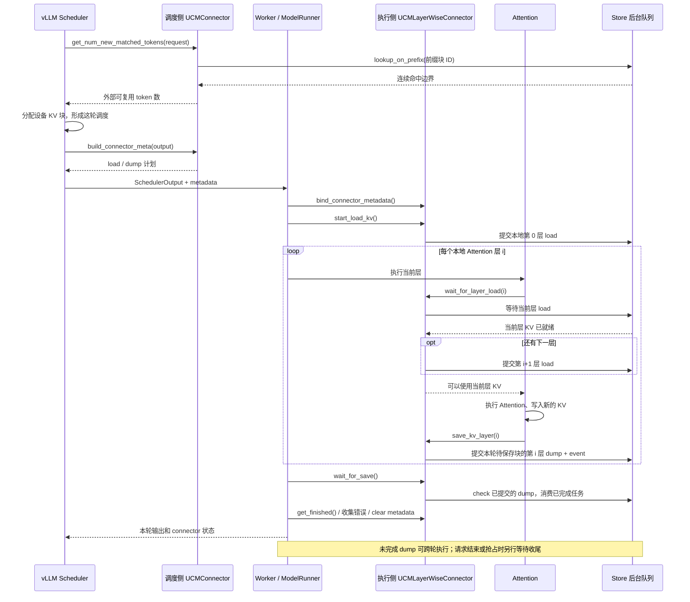

# UCM 的 Layer-wise 实现与 vLLM 调用流程

分析对象：`/Users/chyanmio/unified-cache-management` 的当前源码。  
源码提交：`99601e34da57fb8f9bfa735b58488fc7c915b848`。  
整理日期：2026-10-02。

本文以普通模型使用的 `UCMLayerWiseConnector` 为主，补充混合 Attention 模型的另一套实现。结论来自本地源码阅读；没有启动 GPU/NPU 推理，也没有做性能实测。仓库包含多个 vLLM 版本的适配代码，下面会区分公共接口、旧版本的完整调用示例和模型专用补丁，避免把不同版本拼成一条实际运行路径。

## 1. 先用一句话理解

**Layer-wise 的核心是：用到哪一层，就等待那一层的 KV；等待结束后，马上开始搬下一层的 KV，再计算当前层。当前层算出新的 KV 后，又可以异步保存。**

可以把模型想成一条有很多工位的生产线。第 0 层计算时，搬运工准备第 1 层的数据；第 1 层计算时，搬运工准备第 2 层的数据。这样，计算设备就不必先等所有层的数据搬完。

这里搬的是 **KV Cache**，即 Attention 对已处理 token 留下的 Key/Value 数据。复用这些数据，可以跳过相同前缀的大量重复计算。Layer-wise 改变的是 KV 的搬运时机与粒度，模型参数和 Attention 的数学计算仍由 vLLM 执行。

### 和 Direct 模式有什么区别？

普通 Direct 同步加载路径大致是：

```text
加载所有层需要的 KV → 等待加载完成 → 模型计算 → 提交保存
```

普通 Layer-wise 路径是：

```text
先提交第 0 层加载
  ↓
等待第 0 层 → 提交第 1 层加载 → 第 0 层计算 → 提交第 0 层保存
  ↓
等待第 1 层 → 提交第 2 层加载 → 第 1 层计算 → 提交第 1 层保存
  ↓
等待第 2 层 → ……
```

**最关键的代码位于 `wait_for_layer_load()`：它既等待当前层，也负责提前提交下一层。** 普通实现提前提交相邻的一层；并没有在 `start_load_kv()` 中一次发起全部层的加载。

Direct 还有可选的“请求级异步加载”，它是另一种机制，不能把 Direct 一概理解为所有操作都同步。普通 Layer-wise 的保存本身也采用异步任务生命周期。

源码入口：[UCMLayerWiseConnector](/Users/chyanmio/unified-cache-management/ucm/integration/vllm/ucm_connector.py:2727)。

## 2. 仓库中，各部分分别负责什么？

| 部分 | 通俗解释 | 主要位置 |
| --- | --- | --- |
| vLLM Scheduler | 决定这轮运行哪些请求、哪些前缀可以复用，以及分配哪些显存块 | vLLM 的调度器与本仓库的调度补丁 |
| `UCMConnector` | vLLM 看见的统一入口，选择具体实现并转发接口调用 | `ucm/integration/vllm/ucm_connector.py` |
| `UCMDirectConnector` | 提供哈希、查缓存、生成搬运计划、保存任务管理等公共逻辑 | 同上 |
| `UCMLayerWiseConnector` | 在公共逻辑上增加逐层加载、逐层保存与计算重叠 | 同上 |
| `KVCacheLayout` | 根据 vLLM 的显存块编号，算出某层 KV 的实际内存地址 | 同上 |
| `RankConsistencyManager` | 跟踪读写任务及失败信息，帮助调度侧避开已知不完整的多卡缓存 | `ucm/integration/vllm/rank_consistency.py` |
| Store Python 接口 | 把块 ID、层编号和内存地址交给存储后端 | `ucm/store/ucmstore_v1.py`、`ucm/store/pipeline/connector.py` |
| Store C++ 实现 | 后台线程、搬运队列、设备拷贝和存储读写 | `ucm/store/cache/`、`ucm/store/posix/` 等 |
| vLLM patch | 补齐特定 vLLM 版本或模型需要的接入点 | `ucm/integration/vllm/patch/` |

继承关系和转发关系如下。这里的 Scheduler 与 Worker 是两侧分别建立的 connector 实例，它们通过元数据交换计划和结果，并不是共同操作同一个 Python 对象。

```text
vLLM 的 KVConnectorBase_V1
├── UCMConnector                      对外入口
└── UCMDirectConnector                公共实现
    └── UCMLayerWiseConnector         普通逐层实现
        └── UCMCPConnector            上下文并行适配

vLLM 调用 UCMConnector.xxx()
    → self.connector.xxx()
    → 选中的具体实现
```

## 3. vLLM 怎样选中 Layer-wise？

### 3.1 配置入口

仓库示例使用 vLLM 的 `KVTransferConfig` 指定入口类：

```python
KVTransferConfig(
    kv_connector="UCMConnector",
    kv_connector_module_path="ucm.integration.vllm.ucm_connector",
    kv_role="kv_both",
    kv_connector_extra_config={
        "UCM_CONFIG_FILE": "/path/to/ucm_config.yaml"
    },
)
```

UCM YAML 中可以这样明确开启普通逐层路径，并选择一个存储管线：

```yaml
use_layerwise: true
enable_event_sync: true

ucm_connectors:
  - ucm_connector_name: UcmPipelineStore
    ucm_connector_config:
      store_pipeline: "Cache|Posix"
      storage_backends: "/path/to/cache-directory"
      posix_capacity_gb: 10240
      posix_io_engine: "psync"
      posix_data_trans_concurrency: 128
```

这些路径需要按实际环境替换。这个例子说明配置结构，不代表当前机器已经具备完整推理环境。

`Config._load_config()` 的规则是：如果 extra config 包含 `UCM_CONFIG_FILE`，就读取该 YAML；否则可以直接使用非空的 extra config 字典。指定 YAML 时，这里没有再把其他 extra config 字段叠加覆盖进去。

调用链：

```text
vLLM 按 KVTransferConfig 创建 connector
  → UCMConnector.__init__(vllm_config, role, kv_cache_config)
    → Config(...).get_config()
    → 检查模型布局和功能配置
    → 普通模型 + use_layerwise=true
      → UCMLayerWiseConnector.__init__()
        → UCMDirectConnector.__init__()    初始化公共状态
```

有有效配置字典时，`use_layerwise` 未写出的默认值是 `True`。但是，**它并不保证所有模型最终都使用普通 `UCMLayerWiseConnector`**：`use_lite`、推理计时模式、FA/WA 布局、模拟命中率、上下文并行、混合线性 Attention 等分支会优先选择各自的实现。普通逐层与 Direct 是后面的兜底分支。

选择逻辑：[UCMConnector.__init__](/Users/chyanmio/unified-cache-management/ucm/integration/vllm/ucm_connector.py:3381)。  
配置读取：[Config](/Users/chyanmio/unified-cache-management/ucm/utils.py:34)。  
运行示例：[offline_inference.py](/Users/chyanmio/unified-cache-management/examples/offline_inference.py:20)。

### 3.2 patch 是如何进入 vLLM 的？

仓库提供 `ucm_patch.pth`，并在安装流程中处理它。Python 处理这个文件时会安装 vLLM 导入钩子；真正导入 `vllm` 后，再按环境变量和版本选择补丁。

```text
ucm_patch.pth
  → boot_patch.install_hook()
    → VllmImportTrigger 拦截 vllm 的导入
      → VllmPatchLoader.exec_module()
        → 先加载原来的 vllm
        → apply_all_patches()
          → 检查 ENABLE_UCM_PATCH
          → 检测 vLLM / vllm-ascend 版本
          → 导入适配模块，注册或执行函数替换
```

`ENABLE_UCM_PATCH=1` 或 `true` 会启用这套自动补丁入口。`use_layerwise` 负责选搬运策略，`ENABLE_UCM_PATCH` 负责启用兼容补丁，二者作用不同。

**逐层接口属于 vLLM KV Connector 的接入机制。UCM 实现接口，并在版本或模型需要时补齐调用点。** 例如 `v0110` 适配会替换 Attention 的两个 KV hook 和 model runner 的 connector 上下文；`v0180` 的补丁集合并不重复替换这些同名函数。不能假设所有版本都执行 `v0110/pc_patch.py`。

Ascend 的部分版本还经过一层 `UCMConnectorV1` 包装，内部建立 `_ucm_engine = UCMConnector(...)`，最终转到 UCM 的具体实现。

源码：[导入钩子](/Users/chyanmio/unified-cache-management/ucm/integration/vllm/patch/boot_patch.py:6)、[版本补丁入口](/Users/chyanmio/unified-cache-management/ucm/integration/vllm/patch/apply_patch.py:145)、[v0.11 接入点替换](/Users/chyanmio/unified-cache-management/ucm/integration/vllm/patch/v0110/vllm/pc_patch.py:12)、[Ascend 包装](/Users/chyanmio/unified-cache-management/ucm/integration/vllm/patch/v0180/vllm_ascend/pc/distributed/kv_transfer/kv_pool/ucm_connector.py:13)。

## 4. 搬的是什么？先分清三种编号

普通逐层路径有三个容易混淆的概念：

| 名称 | 表示什么 | 例子 |
| --- | --- | --- |
| `ucm_block_id` | 一段 token 前缀对应的缓存内容标识，是哈希值 | `hash_A` |
| `vllm_block_id` | vLLM 分配的设备 KV 缓冲区中的物理槽位 | `41` |
| `shard_index` | 这个缓存块中的哪一层；普通路径使用模型层编号 | `7` 表示第 7 层 |

可以这样理解：

```text
ucm_block_id 决定“找哪段前缀的数据”
shard_index 决定“找这段前缀的哪一层”
vllm_block_id 决定“把它放到显存的哪个槽位”
```

每个 token 块都有所有层对应的 KV，Layer-wise 将它沿着“层”这个维度切成 shard。K、V 或模型附加缓存张量，属于该层 shard 中的不同组成部分。

还要区分两个同名的 `block_size`：connector 中常指“一个块包含多少 token”；Store 配置中的 `block_size` 是“一整个存储块占多少字节”。Store 的 `shard_size` 是“一层分片占多少字节”。

### 4.1 前缀哈希如何生成？

`RequestHasher.make_request_block_hasher()` 只对完整 token 块生成哈希。每个块的哈希包含前一块的哈希、当前块的 token，以及额外键。这使相同 token 在不同前缀上下文中得到不同缓存标识。模型、并行配置、数据类型和 rank 等信息也参与哈希上下文；请求的额外语义信息通过 extra keys 进入块哈希。

普通非 MLA 的多卡路径中，不同 TP rank 的 KV 分片不同，因此非零 TP rank 会对基准块 ID 再进行 rank 相关哈希。普通 MLA 保存则只由 TP 组内 rank 0 提交，其他 rank 跳过重复保存。

源码：[RequestHasher](/Users/chyanmio/unified-cache-management/ucm/integration/vllm/request_hasher.py:62)。

### 4.2 如何找到某一层、某一个块的显存地址？

Worker 初始化时，vLLM 将已经分配好的 KV 缓冲区传给：

```text
UCMConnector.register_kv_caches(kv_caches)
  → UCMDirectConnector.register_kv_caches(kv_caches)
    → 创建适合模型的 KVCacheLayout
    → 记录层名 → 层编号、张量起始地址、每块字节跨度
    → create_device()
    → _create_store(layout)
      → UcmConnectorFactoryV1.create_connector(...)
```

`KVCacheLayout.extract_block_addrs(..., layer_first=True)` 的核心可以写成：

```text
某层某块的地址 = 该层张量起始地址 + 物理块编号 × 每块字节跨度

结果形状：[本地层数, 要搬的块数, 每层张量组成部分数]
```

比如有 32 层、要搬 5 个块、每层分开存 K 和 V，地址表就可以是 `[32, 5, 2]`。选中第 7 层后，得到 `[5, 2]`，交给 Store 即可直接搬到 vLLM 的原有 KV 缓冲区。

因此，`save_kv_layer()` 虽然接收 `kv_layer`，普通逐层实现真正用来定位数据的，是初始化时注册的 layout 与这轮计划中的块编号。

普通 layout 要求各层张量组成数和每块大小一致。共享 Indexer、MiniMax M3 等模型有专门的 layout；不能把所有模型都简单当成“每层两个一样大的 K/V 张量”。

在 PP（流水线并行）中，每个 worker 只处理自己的层。Store 使用全局层编号，地址表使用本地行号：`local_row = layer_id - first_layer_id`。普通逐层推进还依赖本地层按连续编号运行。

源码：[KVCacheLayout](/Users/chyanmio/unified-cache-management/ucm/integration/vllm/ucm_connector.py:385)、[地址计算](/Users/chyanmio/unified-cache-management/ucm/integration/vllm/ucm_connector.py:547)、[注册 KV 缓冲区](/Users/chyanmio/unified-cache-management/ucm/integration/vllm/ucm_connector.py:1711)。

## 5. Scheduler：先决定哪些块需要读、哪些块需要保存

普通 Layer-wise 继承 Direct 的调度侧逻辑。**逐层改变发生在 Worker 的数据搬运阶段，Scheduler 仍然按 token 块生成计划。**

### 5.1 查找可以复用的前缀

```text
vLLM 调度阶段
  → UCMConnector.get_num_new_matched_tokens(request, num_computed_tokens)
    → UCMDirectConnector.get_num_new_matched_tokens(...)
      → request_block_hasher(request)
      → _rank_consistency.lookup_on_prefix(store, block_ids)
        → store.lookup_on_prefix(block_ids)
      → 记录 HBM 命中边界、总命中边界、已处理 token 数
      → 返回 (外部可复用的 token 数, 是否采用请求级异步加载)
```

`num_computed_tokens` 是本地已复用/已计算的部分。UCM 从这之后找连续命中的前缀，遇到缺块就停止。Store 的 prefix 查询返回“最后命中的下标”，所以代码加 `1` 转成命中块数。

第二个返回值容易误解：它表示是否让整个请求等待请求级异步加载，**不是是否有数据要加载**。普通 `UCMLayerWiseConnector` 不支持 Direct 专属的 `use_request_async_load`，因此即使命中外部缓存，这里通常仍返回 `False`；数据会在本轮 forward 内逐层加载。

普通逐层路径中，`update_state_after_alloc()` 继承父类，但因为请求级异步加载没有启用，会直接返回。它不是普通逐层策略生成主要搬运计划的地方。

### 5.2 生成 Worker 要执行的搬运计划

```text
vLLM 分配 KV 槽位并组织 SchedulerOutput
  → UCMConnector.build_connector_meta(scheduler_output)
    → UCMDirectConnector.build_connector_meta(...)
      → _generate_dispatch_meta(req_meta, new_tokens, vllm_block_ids, need_load)
      → UCMConnectorMetadata(request_meta, preempted_req_ids)
  → 随 SchedulerOutput 交给 Worker
```

计划中，每个请求的 `RequestDispatchMeta` 包含：

```python
load_block_ids = (需要读取的 UCM 块 ID, 目标 vLLM 物理块编号)
dump_block_ids = (需要保存的 UCM 块 ID, 来源 vLLM 物理块编号)
```

逻辑上，前缀分成三个区域：

```text
| 本地 HBM 已有的块 | 外部缓存命中的块 | 这轮新算出来的完整块 |
|      不用搬      |      LOAD      |         DUMP         |
```

新进入的请求通常同时需要 load 与 dump；chunked prefill 的后续轮次主要 dump 新形成的完整块；抢占恢复可能重新需要 load。普通路径不是每生成一个 token 就保存一次，也不是每一轮 decode 都把整个缓存重新保存。

### 5.3 一个完整的数字例子

假设 block size 是 128 token，prompt 有 1280 token，也就是 10 个完整块：

| 前缀块序号 | 状态 | 动作 |
| --- | --- | --- |
| 0～1 | 本地 HBM 命中，256 token | 直接复用 |
| 2～6 | UCM 外部命中，640 token | 每层加载这 5 个块 |
| 7～9 | 尚未计算，384 token | vLLM 计算后，每层保存这 3 个块 |

如果 vLLM 给块 2～6 分配的物理槽位是 `[41, 7, 90, 12, 33]`，load 计划就是对应的 5 个哈希与这 5 个槽位一一配对。它们不需要在显存里连续。

到第 0 层，加载的是这 5 个块的第 0 层 KV；到第 1 层，加载的是同样 5 个块的第 1 层 KV。不是“第 0 层只加载 token 块 0，第 1 层只加载 token 块 1”。

源码：[前缀查询](/Users/chyanmio/unified-cache-management/ucm/integration/vllm/ucm_connector.py:1813)、[计划切分](/Users/chyanmio/unified-cache-management/ucm/integration/vllm/ucm_connector.py:2027)、[组织元数据](/Users/chyanmio/unified-cache-management/ucm/integration/vllm/ucm_connector.py:2083)。

## 6. Worker：普通 Layer-wise 的四个关键函数

### 6.1 `start_load_kv()`：准备计划，只提交本地第一层

调用发生在模型 forward 开始前。函数会：

1. 重置本轮 load 任务、失败请求和已保存层集合等状态。
2. 从 metadata 找出需要 load 的请求。
3. 为每个请求生成全部本地层的目标地址表，记录在 `request_data` 中。生成地址表只是计算指针，不是在搬全部层的数据。
4. 设置 `need_load=True`，提交 `first_layer_id` 的 load。

```text
start_load_kv()
  → layout.extract_block_addrs(vllm_block_ids, layer_first=True)
  → _submit_request_load_tasks_for_layer(first_layer_id, local_row=0, metadata)
    → 对每个请求：shard_indexs = [layer_id] × 块数
    → _rank_consistency.submit_load(store, ..., 当前层目标地址)
      → store.load_data(...)
    → load_tasks[layer_id][request_id] = Task
```

普通路径的加载任务按“层 × 请求”组织，一个任务可以搬这个请求在该层的多个块。提交任务后不在这里等待完成。

源码：[start_load_kv](/Users/chyanmio/unified-cache-management/ucm/integration/vllm/ucm_connector.py:2868)、[提交某层的请求任务](/Users/chyanmio/unified-cache-management/ucm/integration/vllm/ucm_connector.py:2823)。

### 6.2 `wait_for_layer_load()`：等待当前层，提前搬下一层

Attention 在使用该层 KV 前调用它。主要逻辑是：

```text
wait_for_layer_load(layer_name)
  → 没有本轮 metadata 或没有 load 需求：返回
  → layer_name_to_id[layer_name] 得到当前层编号
  → pop 当前层的 load_tasks
  → 对每个请求：_rank_consistency.wait_load(task)
    → store.wait(task)                等 KV 真正到达设备缓冲区
  → 如果本地还有 current_layer_id + 1
    → _submit_request_load_tasks_for_layer(next_layer_id, next_local_row, metadata)
  → 返回给 Attention，开始当前层计算
```

为什么先 `pop` 再等待？因为投机解码、回滚等流程可能再次访问同一层，代码避免对已消费的当前层任务句柄重复执行 `wait()`。这不意味着普通实现的所有加载提交都有统一的“只提交一次”保护；下一层提交仍由这段推进逻辑触发。

**顺序非常重要：下一层 load 的提交发生在当前层 Attention 计算之前。** 这样当前层的 Attention、后续投影/MLP 等工作可以和下一层搬运重叠。若下一层加载较慢，到了下一层时仍然要等待剩余时间。

源码：[wait_for_layer_load](/Users/chyanmio/unified-cache-management/ucm/integration/vllm/ucm_connector.py:2908)。

### 6.3 `save_kv_layer()`：当前层 KV 生成后提交保存

Attention 完成当前层 KV 写入的提交后，触发保存 hook。函数从 dump 计划收集本轮应保存的完整块，并将多个请求合并成这个层的保存任务：

```text
save_kv_layer(layer_name, kv_layer, attn_metadata)
  → 没有 metadata：返回
  → MLA 的非零 TP rank：跳过重复保存
  → 当前层已经在本轮成功提交过保存：返回
  → 汇总各请求的 dump 块 ID、物理槽位、请求 ID
  → _submit_layerwise_dump_task(layer_id, ...)
    → 首次需要时生成 dump_total_ptrs 地址表
    → 取当前本地层的地址，转成连续数组
    → _get_dump_event_handle()
    → _rank_consistency.submit_dump(..., shard_index=layer_id, event_handle)
      → store.dump_data(...)
    → 保存到 _pending_dump_tasks
    → 标记当前层已提交
```

`_dumped_layer_ids` 每轮重置，避免同一批次反复访问同一层时重复保存。这里不会直接阻塞到整个保存完成。

源码：[save_kv_layer](/Users/chyanmio/unified-cache-management/ucm/integration/vllm/ucm_connector.py:2963)、[逐层 dump 提交](/Users/chyanmio/unified-cache-management/ucm/integration/vllm/ucm_connector.py:2768)。

### 6.4 `wait_for_save()`：普通实现中主要轮询，不是全部写完的屏障

当前 `UCMLayerWiseConnector.wait_for_save()`：

1. 给 pending dump 任务记录时间。
2. 调用 `_poll_pending_dump_tasks()`：先 `store.check()`；没完成就保留，完成后才 `wait_dump()` 消费句柄并释放事件。
3. 将本轮有 dump 的请求加入 `_async_dump_req_ids`。
4. 清掉本轮临时的 `dump_total_ptrs`，保留仍在执行的任务。

**普通路径中，它返回时仍可能有保存任务在后台执行。** 外层 `UCMConnector.wait_for_save()` 的 docstring 仍描述“阻塞直到全部保存结束”，但具体普通逐层实现已经不是这个行为。读源码时应以实际方法体为准。

请求结束及抢占阶段承担后续的等待和收尾，详见第 9 节。

源码：[普通逐层 wait_for_save](/Users/chyanmio/unified-cache-management/ucm/integration/vllm/ucm_connector.py:3011)、[pending 任务轮询](/Users/chyanmio/unified-cache-management/ucm/integration/vllm/ucm_connector.py:2444)。

## 7. 这些函数具体插在 vLLM 的什么位置？

从 UCM 接口的职责看，一轮 model runner 执行的接入顺序是：

```text
接收 SchedulerOutput
  → bind_connector_metadata()
  → start_load_kv()
  → 执行模型 forward
      → 每个 Attention 层：
          wait_for_kv_layer_from_connector(layer_name)
            → UCMConnector.wait_for_layer_load()
              → UCMLayerWiseConnector.wait_for_layer_load()
          Attention backend forward / KV 写入
          maybe_save_kv_layer_to_connector(layer_name, kv_cache)
            → UCMConnector.save_kv_layer()
              → UCMLayerWiseConnector.save_kv_layer()
  → wait_for_save()
  → get_finished()、收集无效块及 connector 输出
  → clear_connector_metadata()
  → 将结果返回 Scheduler
```

这是接口层面的主要关系。不同版本具体放在哪个上下文管理器、如何收集 worker metadata，会有差异。

### 仓库中可以直接核对的旧版本调用示例

`v0110` 的 `_get_kv_connector_output()` 是一个上下文管理器：

```python
# 根据仓库代码省略细节后的结构
connector.bind_connector_metadata(scheduler_output.kv_connector_metadata)
connector.start_load_kv(get_forward_context())
try:
    yield output  # model runner 在这个区间执行 forward
finally:
    if wait_for_save:
        connector.wait_for_save()
    output.finished_sending, output.finished_recving = connector.get_finished(...)
    output.invalid_block_ids = connector.get_block_ids_with_load_errors()
    connector.clear_connector_metadata()
```

同版本的 Attention helper 会先检查是否启用了 v1 KV transfer group、是否绑定 metadata、是否有真实的 Attention metadata，然后才转发 wait/save。这样，未启用 connector 或部分无真实 metadata 的执行就会跳过这些 hook。

源码：[model runner 上下文](/Users/chyanmio/unified-cache-management/ucm/integration/vllm/patch/v0110/vllm/pc/v1/worker/kv_connector_model_runner_mixin.py:15)、[Attention 的 wait/save helper](/Users/chyanmio/unified-cache-management/ucm/integration/vllm/patch/v0110/vllm/pc/attention/layer.py:9)。

仓库的 `v0110` sparse Attention 适配中，能直接看到 `wait → self.impl.forward → save` 的完整排列；其中还有稀疏算法的 begin/finished hook，普通 layer-wise 不依赖开启稀疏算法。

示例：[unified_attention](/Users/chyanmio/unified-cache-management/ucm/integration/vllm/patch/v0110/vllm/sparse/attention/layer.py:17)。

### 新模型为什么还需要专用补丁？

某些模型使用自定义 Attention，没有经过通用的 wait/save helper。此时就算配置了 layer-wise，也可能无法推进到下一层。

例如仓库为 Kimi-K3 的自定义 MLA forward 增加入口 wait 和出口 save；MiniMax M3 的自定义 Attention 也有相应适配。这些补丁的目的，是把模型自己的计算路径接回 connector 生命周期。

源码：[Kimi-K3 hook](/Users/chyanmio/unified-cache-management/ucm/integration/vllm/patch/v0270/vllm/models/kimi_k3/nvidia/kimi_k3_mla_kv_hook_patch.py:1)、[MiniMax M3 Ascend hook](/Users/chyanmio/unified-cache-management/ucm/integration/vllm/patch/v0260/vllm_ascend/minimax_m3_kv_transfer_patch.py:1)。

## 8. Python 提交任务后，谁在后台真正搬数据？

Layer-wise 的 Python 代码负责确定“何时搬、搬哪个层、搬哪些块、目标地址在哪”。后台 C++ 队列与设备拷贝流负责搬数据。重叠并不依靠 Python 写一个并行层计算循环。

以 `UcmPipelineStore` 和 `Cache|Posix` 为例：

```text
_rank_consistency.submit_load / submit_dump
  → UcmPipelineStore.load_data / dump_data       Python
    → self.store_.Load / Dump                   C++ 绑定
      → MakeTaskDesc()                          组装 owner、index、addrs
      → StoreBack()->Load / Dump
        → CacheStore::Load / Dump
          → TransManager::Submit
            → TransManager::Dispatch
              → LoadQueue / DumpQueue
                → 后台线程 + CopyStream + Posix 后端
```

`Cache|Posix` 的 builder 先构建 Posix，再将 Cache 叠在上面。对外操作先进入 Cache，Cache 再通过 `store_backend` 转给 Posix。其他管线使用不同后端，不能一律认为所有配置都经过 Cache 或 SSD。

### 8.1 加载链

```text
取某个 owner / shard 的主机缓冲区
  → 缓冲区已有数据：使用缓存
  → 尚未就绪：读取后端并等待就绪
  → HostToDeviceAsync()，复制到 layout 算出的设备地址
  → 同步该搬运流，报告任务完成
  → Python 的 wait_load() 返回
  → 当前层 Attention 可以安全使用 KV
```

Cache 的加载阶段还会尝试为同一块的下一 shard 预分配缓冲。它和 Python 提前提交下一层是两个层面的安排：一个推进模型层的设备加载，一个准备 Store 内部的缓冲空间；`Prealloc()` 本身不代表已经完成下一层的存储读取。

### 8.2 保存链与事件同步

GPU/NPU kernel 的 Python 调用返回，并不等于设备已经完成 KV 写入。所以需要计算流与搬运流之间的先后约束：

```text
Attention 提交当前层 KV 写入
  → Device.get_event_handle() 在当前计算流记录事件
  → event_handle 随 dump_data 传给 C++
  → DumpQueue::DumpOneTask()
    → CopyStream::WaitEvent(event_handle)
    → DeviceToHostAsync()
    → 同步搬运流，确认主机缓冲区已经有数据
    → backend_->Dump() 提交后端写入
```

因此，事件表示“搬运必须在此前的计算写入完成后进行”。它不会要求 Python 先等所有设备工作结束。如果关闭事件同步，或无法取得有效事件句柄，`_get_dump_event_handle()` 会退回设备同步。

### 8.3 “保存任务完成”不一定等于“磁盘写完”

在当前 Cache 实现中，`DumpQueue::DispatchOneTask()` 在 `DumpOneTask()` 返回后就对外报告任务完成。此时设备到主机的拷贝已结束，后端 dump 已提交；后台 `BackendDumpStage()` 还会继续等待后端任务，并持有需要的主机缓冲。

所以至少有三个不同时间点：

```text
1. save_kv_layer() 返回              已提交异步任务
2. Cache dump 任务完成               KV 已脱离原显存，后端写入已提交
3. 后端写入任务结束                  后端处理结束
```

释放 vLLM 原显存块主要关心第 2 点。第 3 点也不能自动等同于断电后仍可恢复的持久化保证，需要看具体存储后端的语义。

普通 Posix 分片路径按 `shard_size × shard.index` 算读写偏移；同一个块 ID 的不同层，可以对应同一块文件中的不同位置。逐层处理并不要求“每层一个独立文件”。

源码：[Python Store](/Users/chyanmio/unified-cache-management/ucm/store/pipeline/connector.py:153)、[C++ 描述与转发](/Users/chyanmio/unified-cache-management/ucm/store/pipeline/cpy/pipeline_store.py.cc:121)、[Cache 分派](/Users/chyanmio/unified-cache-management/ucm/store/cache/cc/trans_manager.h:57)、[加载拷贝完成](/Users/chyanmio/unified-cache-management/ucm/store/cache/cc/load_queue.cc:189)、[dump 任务完成边界](/Users/chyanmio/unified-cache-management/ucm/store/cache/cc/dump_queue.cc:97)、[dump 拷贝及后端提交](/Users/chyanmio/unified-cache-management/ucm/store/cache/cc/dump_queue.cc:114)、[设备事件](/Users/chyanmio/unified-cache-management/ucm/integration/vllm/device.py:115)、[Posix 写入偏移](/Users/chyanmio/unified-cache-management/ucm/store/posix/cc/trans_queue.cc:152)。

## 9. 保存还在后台执行时，怎样避免显存块过早释放？

普通逐层保存跨越 forward 生命周期，使用以下机制收尾：

```text
build_connector_meta() / wait_for_save()
  → 标记有异步 dump 的请求

Scheduler 发现请求结束
  → request_finished() / request_finished_all_groups()
    → 有异步 dump 标记时返回 True
    → 向 vLLM 表示该请求的块需要延迟释放

Worker 得到 finished_req_ids
  → get_finished(finished_req_ids)
    → 找到已结束且有异步 dump 的请求
    → 等待所有涉及这些请求的 pending dump 任务
    → _rank_consistency.finish_dump()
    → 返回 finished_sending

Scheduler 收到完成通知
  → 按 vLLM 的 connector 完成协议处理延迟释放的块
```

`get_finished()` 对已结束请求相关的 dump **会执行等待**；它不是只返回一份任务状态。由于一个层的 dump 可能合并多个请求，等待该任务也可能同时等待其他请求的数据。

抢占也是一个显存可能被改写/复用的节点：`handle_preemptions()` 会对涉及被抢占请求的 pending dump 调用 `_flush_pending_dump_tasks()`，先完成相关收尾。

清理本轮 connector metadata 不等于取消后台任务。Pending task 保存独立句柄、请求集合与事件信息，因此可以在后续轮次继续收尾。

源码：[请求完成与任务收尾](/Users/chyanmio/unified-cache-management/ucm/integration/vllm/ucm_connector.py:2636)、[get_finished](/Users/chyanmio/unified-cache-management/ucm/integration/vllm/ucm_connector.py:2700)、[抢占处理](/Users/chyanmio/unified-cache-management/ucm/integration/vllm/ucm_connector.py:2485)。

## 10. 加载失败如何回到 Scheduler？

查缓存时命中，并不保证稍后加载时一定存在；缓存可能被淘汰，多卡之间也可能有不完整的块。

普通逐层路径的处理是：

1. `submit_load()` 或 `wait_load()` 失败，记录该请求失败。
2. 把该请求 load 和 dump 计划中的相关 vLLM 块加入无效块集合。
3. 后续层的 load 提交跳过这个失败请求。
4. `get_block_ids_with_load_errors()` 和 worker metadata 将问题带回调度侧。
5. 调度侧依据 vLLM 的失败策略处理结果，不能将失败加载的 KV 当作有效缓存继续使用。

`RankConsistencyManager` 还会识别 `StoreNotFoundError`，记录缺失的基准块 ID。Scheduler 的下一次查询过滤已知缺失前缀；成功 dump 的信息可用于更新这些记录。它不是每一层 load 都执行一次跨卡 collective 同步，而是围绕任务上下文和 worker 结果做一致性跟踪。

不要把“记录失败”理解为当前 Attention hook 一定立即抛异常中止：普通实现捕获异常、记录无效块，再由引擎的输出与恢复机制处理。也不要仅凭方法名保证所有模型都支持 recompute：当前 `UCMConnector` 明确拒绝启用混合多组 KV cache 时的 `kv_load_failure_policy='recompute'` 组合。

源码：[一致性管理](/Users/chyanmio/unified-cache-management/ucm/integration/vllm/rank_consistency.py:89)、[调度侧应用 worker 结果](/Users/chyanmio/unified-cache-management/ucm/integration/vllm/ucm_connector.py:2612)。

## 11. 两个容易漏掉的特殊点

### 11.1 全量命中为什么还会保留一点计算？

当前 `_get_full_hit_recompute_tokens()` 中，普通 Layer-wise 会保留至少 2 个 token 的重新计算；有投机解码时，使用 `num_speculative_tokens + 2`。Direct 路径通常保留 1 个。

前缀查询函数会相应减少返回给 vLLM 的外部命中 token 数。这是源码为避免全命中情况下进入跳过逐层 hook 的 FULL CUDA Graph 路径所做的适配，不是说缓存最后两个 token 一定不存在。

同时，当前 `requires_piecewise_for_cudagraph()` 的判断来自推理计时模式，没有仅因为 `use_layerwise=true` 就全局强制 PIECEWISE。仓库离线示例使用 `enforce_eager=True`，也不能据此说 Layer-wise 永远要求关闭图执行。

源码：[全命中保留 token](/Users/chyanmio/unified-cache-management/ucm/integration/vllm/ucm_connector.py:1547)、[图模式判断](/Users/chyanmio/unified-cache-management/ucm/integration/vllm/ucm_connector.py:3374)。

### 11.2 混合线性 Attention 的 Layer-wise 按“层组”推进

`UCMHybridLinearAttentionLayerWiseConnector` 位于 `hla_connector.py`，主要处理 Full Attention 与线性 Attention 状态混合的布局。这里一个 row 可以包含多个层/状态，不能直接套用普通“一层就是一个 shard”的解释。

当前实现的差异：

| 环节 | 普通 Layer-wise | 混合线性 Attention Layer-wise |
| --- | --- | --- |
| 调度单位 | 模型层 | 布局 row / 层组 |
| 开始加载 | 只提交本地第一层 | 同步已有状态拷贝；提交前几个 row，等待 row 0 |
| 等待 hook | 等当前层，再提交下一层 | 在当前 row 的 Full Attention hook 处，确保下一 row 就绪 |
| 预取窗口 | 相邻一层的设备加载 | `hybrid_layerwise_prefetch_rows`，默认 2；启动可提交最多 3 个 row |
| 保存触发 | 当前层首次成功提交 | 当前 row 指定的保存层触发，避免重复提交 |
| forward 末尾 | 轮询 pending dump，可跨轮执行 | `wait_for_save()` 逐 row 等待 dump 任务 |

为什么要提前等待下一 row？代码注释说明，相关 vLLM 路径只在一组末尾的 Full Attention 调用 wait hook，而下一组的线性 Attention 可能更早使用状态。因此 row 0 必须在 forward 前就绪，下一组也要在当前组的 hook 中提前准备好。

这里“等待所有 dump”仍是 Store 任务层面的完成；如果底层使用 Cache，也要区分设备拷贝完成与后端落盘。

源码：[混合逐层实现](/Users/chyanmio/unified-cache-management/ucm/integration/vllm/hla_connector.py:1585)、[混合 start/load](/Users/chyanmio/unified-cache-management/ucm/integration/vllm/hla_connector.py:1792)、[混合 wait_for_save](/Users/chyanmio/unified-cache-management/ucm/integration/vllm/hla_connector.py:1964)。

## 12. 为什么可能更快？收益边界在哪里？

收益来自把“等待搬运”隐藏到“正在计算”的时间中，不是少搬了相同前缀的层数。

用一个只考虑加载与计算的简化例子：3 层，每层加载 5 ms、计算 8 ms。

```text
先加载完全部层：3 × 5 + 3 × 8 = 39 ms

逐层重叠：
  开始先加载第 0 层                  5 ms
  第 0 层计算，同时加载第 1 层        8 ms
  第 1 层计算，同时加载第 2 层        8 ms
  第 2 层计算                         8 ms
  合计                              29 ms
```

这只是帮助理解的理想模型，没有包含保存、队列等待、设备资源竞争与其他模型算子。如果搬运比计算慢，下一层仍会等待；如果没有外部命中，就没有加载可重叠；如果小任务太多，逐层提交和调度开销也可能明显。

逐层搬运还使 Store 可以按 shard 使用和复用主机中转缓冲。但 **普通逐层实现仍然向 vLLM 已分配的各层 KV 缓冲区写数据，并没有在这里实现“显存只保留一层 KV”的滚动内存方案**。不要直接把 layer-wise 等同于显存占用降到一层。

若要判断实际重叠效果，可以结合 hook 等待时间、Cache H2D/D2H 时间、设备时间线与端到端延迟。仓库的 `layerwise_layer_load_duration_ms` 是从该层加载开始到 wait 返回的墙钟时间，包含排队、传输以及可能重叠的时间；它不是纯设备 DMA 时间，也不是实际节省的时间。各层时间相加也不等于整个请求的加载阻塞总时长。

## 13. 一张图把普通路径串起来



图中的 Store 代表一套存储体系；Scheduler 的查询实例和 Worker 的搬运实例可以是不同对象。

## 14. 读源码时，建议按这个顺序

| 顺序 | 看什么 | 要回答的问题 |
| --- | --- | --- |
| 1 | `UCMConnector.__init__()` | 配置和模型为什么选择这个实现？ |
| 2 | `register_kv_caches()`、`KVCacheLayout.extract_block_addrs()` | KV 在哪里，层和块如何转换成地址？ |
| 3 | `get_num_new_matched_tokens()` | Scheduler 如何知道可以跳过多少计算？ |
| 4 | `_generate_dispatch_meta()`、`build_connector_meta()` | 这一轮哪些块 load，哪些块 dump？ |
| 5 | `UCMLayerWiseConnector.start_load_kv()` | 第一层加载如何启动？ |
| 6 | `wait_for_layer_load()` | 下一层如何在当前层计算前开始加载？ |
| 7 | `save_kv_layer()`、`_submit_layerwise_dump_task()` | 如何安全地异步保存当前层 KV？ |
| 8 | `wait_for_save()`、`get_finished()`、`handle_preemptions()` | 后台任务如何结束，显存何时可以复用？ |
| 9 | `UcmPipelineStore`、C++ LoadQueue/DumpQueue | 后台谁在搬运，任务完成意味着什么？ |
| 10 | `hla_connector.py`、特定版本/模型 patch | 当前模型是否走另一套逐层方案或 hook？ |

最值得记住的调用关系是：**Scheduler 生成块级搬运计划 → Worker 绑定计划 → forward 前启动首层加载 → Attention 前等当前层并加载下一层 → Attention 后提交当前层保存 → 通过任务生命周期安全收尾。**
