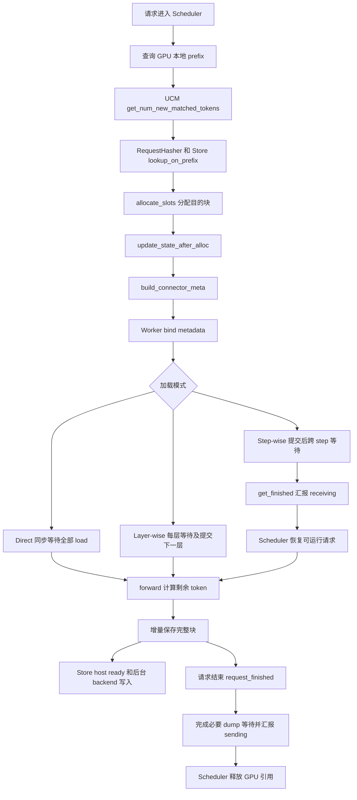

# UCM 整体流程：以 Prefix Cache 为主线

分析日期：2026-10-03。

源码基准：UCM `/Users/chyanmio/unified-cache-management`，`step_wise` 分支，提交 `99601e34da57fb8f9bfa735b58488fc7c915b848`。vLLM 流程对照你的 clone `/Users/chyanmio/vllm`，提交 `fa212b8dc5de5f0cd7b3171e7c7f584bb5a69c53`。

本文描述当前 UCM 的设计和实际函数逻辑，并对照本地新版 vLLM 的调用位置。两边源码能够对应出生命周期，不表示当前 UCM 已经完成新版 vLLM 的全部适配；layout 等具体适配问题见 [新版 KV Cache Layout 分析](/Users/chyanmio/note/vllm_new_kv_cache_layout_analysis.md)。不展开 UCM 支持的各个旧版本 patch。

## 1. UCM 的 Prefix Cache 在做什么

模型处理 prompt 时，每一层会产生 K/V 或其他可复用状态。另一个请求如果具有相同前缀，就可以复用这段状态，减少重复 prefill 计算。

vLLM 本身已经能复用 GPU/HBM 里的前缀。UCM 在外面增加了更大的缓存空间：把这些状态保存到 host memory、SSD 或其他存储，在 GPU 中的 cache 不在时重新搬回来。

整个流程可以先记成：

```text
输入经 vLLM 前端处理为 token IDs 和 Request
→ 请求进入 Scheduler
→ 查 GPU 中的前缀
→ 查 UCM 外部存储中的剩余前缀
→ 分配 GPU 目的块并生成搬运计划
→ 加载已命中的 cache
→ 计算剩余 token
→ 保存新完成的完整块
→ 后续请求复用
```

UCM 还有 sparse attention 等模块，但 prefix cache 这条主线主要经过 `ucm/integration/vllm`、`ucm/store` 和设备传输模块。命中 prefix cache 的作用是减少重复计算；减少每次 attention 读取范围则属于另一类机制，本文不展开。

## 2. 先分清各个模块负责什么


| 模块                                      | 通俗理解                 | 负责的事情                                                          |
| ------------------------------------------- | -------------------------- | --------------------------------------------------------------------- |
| vLLM Scheduler                            | 排队和安排工作的人       | 查本地命中、询问外部命中、安排 token、分配/释放 block、推进请求状态 |
| vLLM KVCacheManager / BlockPool           | GPU cache 的账本         | hash 到 GPU block 的映射、block table、引用计数、空闲块和淘汰       |
| `UCMConnector`                            | UCM 的统一入口           | 读取配置、选择具体 connector、转发 vLLM 的回调、记录统计            |
| Direct / LayerWise / HLA / FAWA connector | 查询与搬运的协调者       | 算外部 key、查命中、生成 load/dump 计划、提交任务、汇报完成和错误   |
| `RequestHasher`                           | 给一段前缀生成名字       | 根据完整前缀语义生成外部缓存 key                                    |
| `KVCacheLayout` 等类                      | 地址换算器               | 把 GPU block ID 换成一个或多个实际内存地址                          |
| `RankConsistencyManager`                  | 缺失数据的记录与反馈层   | 记录跨 rank 缺失、跟踪任务、帮助后续查询避开已知不完整块            |
| Store Python wrapper                      | Python 到 C++ 的桥       | 将 key、shard、地址列表传入底层 store                               |
| CacheStore                                | host buffer 和设备搬运层 | 管理 host cache，协调 H2D/D2H 和 backend I/O                        |
| Posix / Mooncake / 其他 backend           | 实际存储层               | 检查内容是否存在，读取和保存数据，按后端策略管理容量                |

这里有两个容易混淆的“connector”：`UCMConnector` 是 vLLM 集成入口，`UcmConnectorFactoryV1` 创建的是具体存储 wrapper，例如 `UcmPipelineStore`。

源码：[集成入口](/Users/chyanmio/unified-cache-management/ucm/integration/vllm/ucm_connector.py:3372)、[Store factory](/Users/chyanmio/unified-cache-management/ucm/store/factory_v1.py:34)。

## 3. Prefix cache 的几个基本概念

### 3.1 缓存里放的是计算状态，不是回答文本

相同前缀可以复用 KV，随后仍然要继续执行模型并生成回答。两个共享前缀的请求，可以有不同后续输入、不同生成结果。

### 3.2 普通 Direct 路径按完整 token block 缓存

假设 `block_size=4`，prompt 有 22 个 token：

```text
b0：token 0～3
b1：token 4～7
b2：token 8～11
b3：token 12～15
b4：token 16～19
尾部：token 20～21，只占半块
```

`RequestHasher` 为前 5 个完整块生成 key，半块尾部不生成 key。可以把它理解成“装满一盒才按这套协议保存”。GPU 仍会给尾部提供计算空间；只是通用外部 prefix cache 不把这个半块当作完整可复用项。

混合模型有自己的 block/state 边界，后文单独介绍。

### 3.3 外部 key 和 GPU block ID 是两种东西


| 标识                  | 表达什么                          | 能否跨请求复用                                |
| ----------------------- | ----------------------------------- | ----------------------------------------------- |
| UCM key，例如`h2`     | 某段前缀的内容身份                | 同一命名空间、相同语义的前缀可以复用          |
| GPU block ID，例如`6` | 当前 worker cache pool 的物理位置 | 是临时位置，之后可能存另一段内容              |
| shard index           | 一个外部 block 中的子内容位置     | 由保存格式决定；layer-wise 中通常对应层 shard |
| task handle           | 这次搬运任务的编号                | 用于 check/wait，不代表缓存内容               |

例如 `(h2, GPU block 6)` 的意思是“把 h2 对应的数据加载到现在分配给它的第 6 个 GPU 块”。下一次同一个 h2 可能加载到 GPU block 19。

### 3.4 查到命中、加载完成、可运行是三个阶段

```text
lookup hit：    store 当前认为这个 key 存在
load complete：需要的数据已经搬运完成，错误检查通过
request ready：scheduler 已收到必要的完成结果，可以安排该请求
```

查询与加载之间可能发生 GC、缺失或存储错误，因此命中不能直接当作已经有可用 GPU 数据。

## 4. 启动阶段：连接 vLLM 与 Store

### 4.1 Scheduler 和 Worker 分别有 connector 实例

同一个 connector 类按照 `KVConnectorRole` 创建不同角色的实例：

- Scheduler 实例主要计算 key、查询命中和生成 metadata，不搬运 GPU tensor。
- Worker 实例注册实际 GPU cache 地址，并提交和等待 load/dump 任务。

它们通过每个 step 的 metadata 和返回结果交流，不是共用一份 Python 字典。

### 4.2 入口会按模型和配置选择实现

`UCMConnector.__init__` 读取配置，并按条件选择实现。常规选择链里 FAWA 的检测优先，其后是 mock、CP、HLA，最后才是普通 LayerWise/Direct；另有 lite 和监控等入口分支。

因此 `use_layerwise=false` 不保证所有模型都选择普通 Direct：混合模型可能走 HLA 或 FAWA。

对普通模型：

```text
use_layerwise=true  → UCMLayerWiseConnector
use_layerwise=false → UCMDirectConnector

普通 Direct + use_request_async_load=true
                   → 请求级异步加载，即你的 step-wise 路径
```

当前 Direct 的 `_supports_request_async_load` 只对这个精确类启用；不能因为某个子类继承了 Direct，就认为它自动支持相同异步模式。HLA/FAWA 的请求异步支持由各自实现管理。

源码：[选择逻辑](/Users/chyanmio/unified-cache-management/ucm/integration/vllm/ucm_connector.py:3498)、[Direct 初始化和异步配置](/Users/chyanmio/unified-cache-management/ucm/integration/vllm/ucm_connector.py:1366)、[配置读取](/Users/chyanmio/unified-cache-management/ucm/utils.py:34)。

### 4.3 Worker 在 cache 分配后注册实际地址

```text
vLLM 分配 cache 并建立各层视图
→ UCMConnector.register_kv_caches
→ 具体 connector.register_kv_caches
→ 选择 KVCacheLayout / 专用 layout
→ 获得 layer 映射、每块字节数、base pointers、stride 等
→ _create_store
→ UcmConnectorFactoryV1.create_connector
→ 创建 UcmPipelineStore 或其他 wrapper
```

Worker 会把设备编号、tensor size、shard size、block size、GPU buffer 注册范围等信息传给 store。Scheduler 的 store 主要需要元数据查询能力；启用 Posix GC 的普通路径中，DP0 scheduler 负责 GC owner。

注意 `block_size` 在不同地方的单位不同：vLLM/connector 里经常是 token 数，store 配置里则是一个外部 block 的字节数。它们不是同一个数字。

源码：[cache 注册](/Users/chyanmio/unified-cache-management/ucm/integration/vllm/ucm_connector.py:1711)、[Store 配置构造](/Users/chyanmio/unified-cache-management/ucm/integration/vllm/ucm_connector.py:1609)。

## 5. 第一阶段：给前缀生成 key

### 5.1 为什么每个块的 key 要包括前一个块

后面 token 的 K/V 会受到前面上下文影响。因此同样的当前 4 个 token，放在不同前缀之后，不能当成同一份 cache。

`make_request_block_hasher` 使用链式计算：

```text
h0 = hash(seed, token[0:4],   extra0)
h1 = hash(h0,   token[4:8],   extra1)
h2 = hash(h1,   token[8:12],  extra2)
...
```

这里是便于理解的写法。实际输入是 tuple，通过 pickle 编码，再由命名空间加 MD5 得到 16 字节 key。

例如两个请求只有前 12 个 token 相同，则 `h0/h1/h2` 相同。从第 4 个完整块开始，只要 token 不同，当前和后续链式 key 都会不同。

### 5.2 namespace 区分不同模型和 rank 等配置

当前 `RequestHasher` 的 namespace 包括：模型路径末尾名称、TP size、模型 dtype、rank ID、speculative 配置、部分 sparse C8 配置。

它不是对所有模型文件和所有运行配置自动做完整指纹。换模型权重、KV dtype/packing/layout 等配置时，不能只因为 token 相同就认为旧 store 数据一定兼容；新版适配时应明确内容格式版本和隔离方式。

### 5.3 不只 token IDs，图片和 LoRA 也影响 key

UCM 调用 vLLM 的 `generate_block_hash_extra_keys`，把多模态内容及位置、LoRA、cache salt、prompt embeddings 等额外语义纳入链式 hash。

如果接口缺失，而请求又有这些额外语义，UCM 会拒绝不完整的 hash；Direct 查询入口捕获异常并退回外部 miss，不能冒用一份仅按 token IDs 匹配的数据。

例如相同文字模板、相同占位 token，但图片不同：图片所在块及后续块应不同，图片之前纯文本的共同前缀仍有机会复用。

### 5.4 vLLM 本地 hash 和 UCM 外部 key 不必是同一个值

vLLM 自己也有链式 block hash，供 `BlockPool` 查本地缓存。UCM 则使用 `RequestHasher` 的 namespace 和 seed，为外部存储单独计算 key。

两者识别的是前缀语义，但实现、编码和命名空间可以不同。不能把 vLLM 的 `request.block_hashes` 直接当成当前 UCM 外部 key 而不检查协议。

源码：[RequestHasher](/Users/chyanmio/unified-cache-management/ucm/integration/vllm/request_hasher.py:61)、[完整块链式循环](/Users/chyanmio/unified-cache-management/ucm/integration/vllm/request_hasher.py:102)、[vLLM 额外语义](/Users/chyanmio/vllm/vllm/v1/core/kv_cache_utils.py:614)、[vLLM 本地 block hash](/Users/chyanmio/vllm/vllm/v1/core/kv_cache_utils.py:684)。

## 6. 第二阶段：先查本地，再查外部

### 6.1 本地 GPU 前缀查询

新请求第一次安排计算时，Scheduler 调用 `_get_local_prefix_cache_hit`，普通路径进入 `KVCacheManager.get_computed_blocks`，再由 coordinator 查最长可复用前缀。

`BlockPool` 中存在类似下面的映射：

```text
(本地 block hash, cache group ID) → GPU block
```

本地命中的块可以直接用于请求，引用计数增加，无须从 UCM 重新搬运。

本地 APC 和外部 UCM 是不同入口：不能把禁用本地 prefix caching 理解成自动禁用外部缓存。当前 Scheduler 还会按请求的 `skip_reading_prefix_cache` 等条件限制外部命中，具体以两个入口各自的配置和判断为准。

当前新版 vLLM 还支持更细的 prefix match unit 和某些混合 group 的不同命中边界。向 UCM 查询时，Scheduler 会把本地命中传成 block-aligned 边界，并协调可能的局部尾块。本文数字例子使用没有这些特殊情况的整块路径。

源码：[scheduler 本地查询](/Users/chyanmio/vllm/vllm/v1/core/sched/scheduler.py:541)、[get_computed_blocks](/Users/chyanmio/vllm/vllm/v1/core/kv_cache_manager.py:264)、[BlockPool 本地索引](/Users/chyanmio/vllm/vllm/v1/core/block_pool.py:198)。

### 6.2 外部查询函数的第二个返回值是什么

```text
UCMConnector.get_num_new_matched_tokens(request, num_computed_tokens)
→ 具体 connector 的同名函数
→ 返回 (external_hit_tokens, load_async)
```

第一个数是“本地命中之外，外部还能补多少 token”，不是总命中 token 数。

第二个 bool 是“请求是否需要进入跨 step 异步加载等待”，不是“是否需要加载”。即使它为 False，只要外部命中大于 0，仍需要走同步或 layer-wise 加载。

### 6.3 Direct 查询的具体逻辑

1. 从 request 生成或复用 UCM block keys。
2. 计算本地命中块数：`hbm_hit_block_num = num_computed_tokens // block_size`。
3. 从本地未覆盖的位置开始外部 `lookup_on_prefix`。
4. 根据连续命中数，计算新增外部命中 token。
5. 必要时留出尾部重算 token。
6. 保存 `RequestMeta`，返回命中数和异步标记。

`persist_token_threshold` 对这个入口的请求长度进行门槛判断。低于门槛时不继续建立普通外部缓存流程；它不是“只影响最后 dump，却仍正常查外部”的开关。

### 6.4 Prefix lookup 的返回值是索引

接口返回最后一个连续存在块的索引，完全 miss 返回 `-1`：

```text
查询 keys： [h1,h2,h3,h4]
是否存在：  [ T, T, F, T]
返回值：     1
连续命中数： 1 + 1 = 2
```

虽然 h4 存在，但 h3 是缺口，普通 full attention 不能直接跳过缺口当作完整 prefix，所以外部命中只有 h1/h2。

源码中的 `lookup_on_prefix(...) + 1` 正是把“最后索引”转换为“数量”。CP 路径还要根据 `cp_world_size` 把 hash 数换回逻辑块数，普通路径这个倍率为 1。

### 6.5 等待队列重复查询有优化，但会重新确认边界

Direct 可以从之前最后一个命中块重新查询，避免每次从头扫描。当这个边界块消失，或本地命中边界发生不适合复用的变化，会回到本地未覆盖的位置重新做完整 prefix 查询。

这个优化保存的是 scheduler-side 查询信息，并不意味着 GPU 已加载，也不保证历史外部内容永远存在。

源码：[Direct 外部查询](/Users/chyanmio/unified-cache-management/ucm/integration/vllm/ucm_connector.py:1813)、[prefix lookup 协议](/Users/chyanmio/unified-cache-management/ucm/store/ucmstore_v1.py:81)、[vLLM 查询 connector 的位置](/Users/chyanmio/vllm/vllm/v1/core/sched/scheduler.py:944)。

## 7. 第三阶段：分配 GPU 块，生成传输计划

### 7.1 命中外部 cache 也要占用 GPU 空间

外部命中避免的是重复 prefill，不是 GPU cache 空间。需要把它加载到已分配的 GPU 块中，后面的 token 才能读取。

Scheduler 调用 `KVCacheManager.allocate_slots`，分配目的块、后续计算空间以及必要的 lookahead 空间。对于 async load，使用 `delay_cache_blocks=True`，避免尚未加载的块过早进入本地可复用索引。

### 7.2 `update_state_after_alloc` 记录真正的目的块

查询时知道 key，不一定知道最终 GPU block ID；分配成功后才能建立映射。

普通 Direct 请求异步路径中的 `update_state_after_alloc`：

```text
读取 blocks.get_block_ids()
→ 取普通 Direct 使用的第一个 group
→ 切出外部命中范围的 GPU block IDs
→ 切出对应 UCM keys
→ 创建 RequestDispatchMeta(load_async=True)
→ 放入 _pending_async_load_dispatches
```

普通 Direct 同步路径在这里没有同样的记录动作，随后通过 scheduled request 信息建立计划。

### 7.3 三种 metadata 各自保存什么


| 对象                                  | 所在位置               | 主要字段和用途                                                                 |
| --------------------------------------- | ------------------------ | -------------------------------------------------------------------------------- |
| `RequestMeta`                         | Scheduler，跨 step     | keys、本地/总命中块数、初次记录的 token 长度、已处理 token、GPU block 列表     |
| `RequestDispatchMeta`                 | 发往 Worker 的单次计划 | `load_block_ids=(keys,gpu_ids)`、`dump_block_ids=(keys,gpu_ids)`、`load_async` |
| `PendingLoadTask` / `PendingDumpTask` | Worker，跨 step        | Store task、请求 IDs、目的块或 event、完成查询所需信息                         |

单次 metadata 清空以后，pending task 仍然可以继续存在。这是 step-wise 能跨 step 工作的关键。

### 7.4 `build_connector_meta` 把本 step 的计划发送出去

对新请求，通常生成 load 和 dump 计划；对 chunked prefill 的后续 step，主要生成新增完整块的 dump 计划；对抢占后恢复的请求，重新协调 load。

异步加载请求不在当前 scheduled request 列表中，所以函数另外合并 `_pending_async_load_dispatches`。否则会出现“请求进入等待状态，却没有任何 Worker 收到 load 任务”的问题。

已经 dispatch 过异步 load 的请求，在真正恢复到 scheduled 列表时，通过 `_async_load_req_ids` 避免再次加载同一段 cache。

源码：[RequestMeta 与 DispatchMeta](/Users/chyanmio/unified-cache-management/ucm/integration/vllm/ucm_connector.py:341)、[分配后异步计划](/Users/chyanmio/unified-cache-management/ucm/integration/vllm/ucm_connector.py:1978)、[计划生成](/Users/chyanmio/unified-cache-management/ucm/integration/vllm/ucm_connector.py:2027)、[metadata 合并](/Users/chyanmio/unified-cache-management/ucm/integration/vllm/ucm_connector.py:2083)、[vLLM allocate 与回调](/Users/chyanmio/vllm/vllm/v1/core/sched/scheduler.py:1224)。

## 8. 第四阶段：三种加载模式怎样接入推理

三种模式共享 prefix 查找的目标，但“何时让请求进入模型”和“如何等待数据”不同。

### 8.1 Direct 同步加载

```text
外部命中
→ 请求进入当前 batch
→ Worker.start_load_kv
    extract_block_addrs 得到目的地址
    RankConsistencyManager.submit_load
    Store.load_data 返回 task
    RankConsistencyManager.wait_load 等待
→ 当前 batch forward
```

Direct 的 `wait_for_layer_load` 是空函数，因为全部需要的数据已经在 start 中等待。它的 `save_kv_layer` 也是空函数，保存由 step 结束阶段统一提交。

### 8.2 Layer-wise 加载

```text
start_load_kv：准备所有层的地址，只提交第一层加载
→ wait_for_layer_load(layer 0)：等待第 0 层，提交第 1 层加载
→ 计算第 0 层
→ save_kv_layer(layer 0)：提交这层的新 cache 保存
→ wait_for_layer_load(layer 1)：等待第 1 层，提交第 2 层加载
→ 计算第 1 层
→ ...
```

所以它的流水不是 start 时一次发完所有层，而是在当前层 wait 后提交下一层，让下一层 I/O 尝试与当前层计算重叠。

同一个外部 block 内通常用 layer shard 区分层内容。重复进入同一层的 speculative/rollback 情况会通过任务 pop、`_dumped_layer_ids` 等状态避免重复 wait/dump。

### 8.3 请求级异步加载，也就是 step-wise

```text
Scheduler：命中 → 分配目的块 → request.status=WAITING_FOR_REMOTE_KVS
Worker：   start_load_kv → 提交 load → 存入 _pending_load_tasks → 返回
后续 step：get_finished → check_load → 完成后 wait_load 检查并释放任务
Scheduler：收到 finished_recving → 调整可用命中 → 放回 WAITING
再调度：   请求真正进入 running batch
```

当前 batch 不包含这个等待请求，其他 running 请求可以继续计算。目的 GPU 块在等待期间仍然被占用。

当前本地新版 vLLM 中，如果这个 step 没有同步加载依赖，会先提交 running batch 的 forward，再调用 `start_load_kv`；有 `has_sync_kv_loads=True` 则提前调用。这里是 forward launch 顺序，不表示一定等设备计算全部结束才加载。

没有 running token 的空 step 也会推进 connector，确保等待请求的任务能启动和汇报。

源码：[Direct start_load_kv](/Users/chyanmio/unified-cache-management/ucm/integration/vllm/ucm_connector.py:2218)、[LayerWise start/wait](/Users/chyanmio/unified-cache-management/ucm/integration/vllm/ucm_connector.py:2868)、[异步任务轮询](/Users/chyanmio/unified-cache-management/ucm/integration/vllm/ucm_connector.py:2654)、[新版 Worker 时序](/Users/chyanmio/vllm/vllm/v1/worker/kv_connector_model_runner_mixin.py:69)、[Scheduler 等待状态](/Users/chyanmio/vllm/vllm/v1/core/sched/scheduler.py:1277)。

## 9. 一个完整请求例子：从查找到新增保存

以下用小 block 帮助理解，不是性能测试配置。使用普通单 group、CP=1、Direct 路径，忽略 lookahead 等额外块。

```text
prompt：22 token
block_size：4 token
完整 keys：[h0,h1,h2,h3,h4]
本地 HBM：只命中 h0，即 4 token
外部查询：[h1,h2,h3,h4] → [T,T,F,T]
新增外部命中：2 块，即 8 token
总可复用前缀：12 token
需要新计算：22 - 12 = 10 token
```

### 9.1 分配之后的请求 block table

```text
逻辑位置：  b0  b1  b2  b3  b4  b5
GPU ID：     8   3   6  11   4   9
用途：     本地 外部 外部 新算 新算 尾部
```

Worker 加载：

```text
h1 → GPU block 3
h2 → GPU block 6
```

h4 虽然在 store 中，但普通 prefix 查询在 h3 缺口处停止，因此它仍走新计算范围。不能因为某个孤立 key 存在，就在这里随意拼接 prefix。

### 9.2 Chunked prefill 第一步再计算 6 token

已复用 12 token，先计算 token 12～17；`token_processed` 从 12 到 18。

`_generate_dispatch_meta` 用整除计算新增完整块：

```text
start_idx = 12 // 4 = 3
end_idx   = 18 // 4 = 4
要 dump 的块范围：[3,4)，即 b3

h3 ← GPU block 11
```

b4 只完成了 token 16、17，还没满，不能按完整块提交。

### 9.3 下一步再计算 4 token

计算 token 18～21，`token_processed` 从 18 到 22：

```text
start_idx = 18 // 4 = 4
end_idx   = 22 // 4 = 5
要 dump 的块范围：[4,5)，即 b4

h4 ← GPU block 4
```

b5 是 token 20～21 的不满块，没有外部完整 key。这说明普通保存不是等请求结束再全量写一次，而是随着完整块完成增量提交。

通用 Direct 的 `RequestMeta` 在查询时记录 keys 和初始 `num_token_ids`，这条链不会每次 decode 都无限追加新 hash。不能把它描述成“所有新生成 token 都会自动持续持久化”。抢占后重新建 metadata、专用 connector 的策略则另看对应实现。

### 9.4 之后再来共享前缀的请求

若 h0～h4 的有效内容已在缓存层中可查询/可加载，新的相同前缀请求就能复用更多状态。先看 GPU 是否还保留这些块；GPU 没保留时，再由 UCM 加载到新分配的 GPU IDs。

最初冷请求如果所有 key 都 miss，也是这个增量保存过程：本地=0、外部=0，从头计算，在各 step 的完整块边界生成 dump。

## 10. 第五阶段：保存、发布可用内容和 block 回收

### 10.1 Direct 的 `wait_for_save` 实际做什么

这个名字容易让人以为它只是在等。当前实现包括：

1. 轮询历史 pending dump tasks。
2. 收集本次 metadata 中需要保存的 requests 和 blocks。
3. 按 rank 转换 store keys。
4. 用 layout 算出源 GPU 地址。
5. 获取前置设备 event；不能用 event 时回退到设备同步。
6. 调用 `submit_dump`，把 task/event/请求 IDs 放入 `_pending_dump_tasks`。

因此函数返回时，新提交的 dump 可能还没完成。

LayerWise 的 `save_kv_layer` 在各层计算后提交 shard dump，`wait_for_save` 则推进历史任务及 step 清理。两条路径共用相应的异步生命周期。

源码：[Direct wait_for_save](/Users/chyanmio/unified-cache-management/ucm/integration/vllm/ucm_connector.py:2497)、[LayerWise 保存](/Users/chyanmio/unified-cache-management/ucm/integration/vllm/ucm_connector.py:2963)。

### 10.2 Python forward 返回不等于 GPU 内容可立即搬走

模型 kernel 可能仍在设备上执行。UCM 获取的 event 被 store 作为 `prerequisite_handle` 接收，CacheStore 的 dump stream 在 D2H 前等待它。

没有可用 event 时，代码会同步设备再提交。这样才能避免 host 读到尚未完成的 K/V。

### 10.3 请求结束时，先保护还在被读取的源块

Scheduler 调用 `request_finished` / `request_finished_all_groups`。普通 Direct 若该请求涉及异步 dump，会返回 `delay_free=True`。

接下来 Worker 的 `get_finished` 收到 finished request IDs，会协调这个请求的 pending dump tasks，完成必要的等待，并返回 `finished_sending`。Scheduler 才能释放这些 blocks。

这里普通路径的“异步保存”主要表现为请求计算期间任务在后台推进；请求结束的清理阶段仍可能主动等待相关 dump，而不是对保存任务始终只做无阻塞轮询。

请求被 preempt 时，`handle_preemptions` 同样 flush 相关 pending dumps，避免源块被新内容覆盖时旧任务还在读取。新版 vLLM 的 stale-output/deferred-free 策略也需要协调，不能只保留 Store task 而不保留源数据。

源码：[request_finished](/Users/chyanmio/unified-cache-management/ucm/integration/vllm/ucm_connector.py:2636)、[get_finished](/Users/chyanmio/unified-cache-management/ucm/integration/vllm/ucm_connector.py:2700)、[preemption flush](/Users/chyanmio/unified-cache-management/ucm/integration/vllm/ucm_connector.py:2485)、[Scheduler 完成与释放](/Users/chyanmio/vllm/vllm/v1/core/sched/scheduler.py:2970)。

### 10.4 释放 GPU block 不等于立刻抹掉 prefix cache

本地 `BlockPool.free_blocks` 会减少引用计数。归零的缓存块可以放回可回收队列，但 hash 映射和内容可能继续存在。

另一请求命中时，通过 `touch` 增加引用并从空闲队列移除。只有这块被重新分配、淘汰旧 hash，原本的本地 prefix 才失效。

所以“请求结束”“GPU block 没人引用”“GPU cache 被淘汰”是不同事件。外部 UCM 数据也有自己的容量管理，不随一次请求的 GPU free 自动消失。

源码：[BlockPool touch/free](/Users/chyanmio/vllm/vllm/v1/core/block_pool.py:754)、[新分配与旧 cache 淘汰](/Users/chyanmio/vllm/vllm/v1/core/block_pool.py:669)。

## 11. Store 内部的数据究竟怎么走

以当前代码里的 `Cache|Posix` 为例，不代表所有 backend 都走相同路径。

### 11.1 Pipeline 是一层层接起来的

Builder 先 `Stack(Posix)`，再 `Stack(Cache)`。每层保存已有 entry 作为 backend，最后 Cache 成为对外入口：

```text
UcmPipelineStore Python wrapper
→ pybind PipelineStore
→ CacheStore
→ PosixStore
```

这里不是“先运行 Python Cache，再运行 Python Posix”，而是 C++ store 对象串联。其他 builder 可以加入压缩、远端存储等不同层。

源码：[PipelineStore wrapper](/Users/chyanmio/unified-cache-management/ucm/store/pipeline/connector.py:91)、[Cache|Posix builder](/Users/chyanmio/unified-cache-management/ucm/store/pipeline/connector.py:212)、[C++ Stack](/Users/chyanmio/unified-cache-management/ucm/store/pipeline/cpy/pipeline_store.py.cc:151)。

### 11.2 Lookup 查的是存在性，不是将数据全部加载到 GPU

CacheStore 的 `BufferManager` 先看 host buffer 有哪些 key；缺失部分再查 backend，并合成最长连续 prefix。

Posix 的 prefix lookup 通过工作线程检查 key 对应的已发布文件，并返回最早 miss 之前的最后索引。这个操作只确认存在性，不替代后面的数据读取与校验。

源码：[host/backend prefix 合并](/Users/chyanmio/unified-cache-management/ucm/store/cache/cc/buffer_manager.h:137)、[Posix prefix 查询](/Users/chyanmio/unified-cache-management/ucm/store/posix/cc/space_manager.cc:76)。

### 11.3 Load：host 命中可以跳过 backend 读取

```text
load_data(keys, shard_indices, GPU 目的地址)
→ CacheStore.Load
→ LoadQueue.DispatchOneTask
    host shard 已 Ready：直接使用
    host shard 未 Ready：owner 发起 backend.Load 到 host buffer
→ LoadQueue.TransferOneTask
    等待 backend 或其他 owner 准备好内容
    HostToDeviceAsync
    在相应任务完成边界同步传输 stream
→ check / wait 将完成结果交回 connector
```

共享 host buffer 下，其他任务可能是同一个 shard 的 owner；当前任务会等它 ready，减少重复加载。

UCM 外部命中率包含 host cache 和 backend 的命中，不能直接当成“SSD 命中率”。

源码：[Load 调度](/Users/chyanmio/unified-cache-management/ucm/store/cache/cc/load_queue.cc:101)、[H2D 与同步](/Users/chyanmio/unified-cache-management/ucm/store/cache/cc/load_queue.cc:193)、[等待 host/backend ready](/Users/chyanmio/unified-cache-management/ucm/store/cache/cc/load_queue.cc:249)。

### 11.4 Dump：host ready 与 backend 完成是两个时点

当前 CacheStore 的关键顺序是：

```text
dump_data(keys, shard_indices, GPU 源地址, event)
→ DumpQueue.DispatchOneTask
→ DumpOneTask
    等前置 event
    获得 host buffer shard
    需要时执行 D2H
    同步传输 stream
    MarkReady，使 host 内容可用
    backend.Dump，提交后端写入
    将 backend task 放入 dumping_ 队列
→ 当前 Cache transfer 的 waiter.Done

另外的 BackendDumpStage：
    backend.Wait，推进后端写入完成并释放相关持有资源
```

因此当前 `Cache|Posix` 的外层 dump task 完成，可以先于 backend task 完成。GPU 源块可以在不再被读取后回收，host 内容也可能已经能供缓存加载，而后台写入仍在推进。

不要把这三个指标混成一个：

```text
GPU → host 搬运完成
host cache 内容 ready
backend 写入完成 / 持久化语义
```

尤其不能从 connector 的 `finished_sending` 推导“已经具备断电持久性”。后者要看实际 backend 和文件同步策略。后台 backend.Wait 错误也有单独的日志和计数，不应仅观察外层 transfer 成功。

源码：[DumpOneTask](/Users/chyanmio/unified-cache-management/ucm/store/cache/cc/dump_queue.cc:114)、[外层 waiter 完成](/Users/chyanmio/unified-cache-management/ucm/store/cache/cc/dump_queue.cc:97)、[独立 backend 等待阶段](/Users/chyanmio/unified-cache-management/ucm/store/cache/cc/dump_queue.cc:209)。

### 11.5 Posix 用临时文件和发布文件区分内容

同一个 key 的写入阶段文件带 `.tmp` 后缀；`CommitFile(success=True)` 将它 rename 成正式文件。失败则清理临时文件。

prefix lookup 查询正式文件，而不是只要看到 `.tmp` 就认为 cache 命中。这与上面的 host MarkReady 是不同层的可见性规则。

当前使用的是 `UcmKVStoreBaseV1`，Python connector 主线没有调用旧 `ucmstore.py` 中的显式 `create/commit` API。Posix 的文件发布在 backend 内部完成，不能把旧 API 的调用图直接套过来。

源码：[V1 Store 接口](/Users/chyanmio/unified-cache-management/ucm/store/ucmstore_v1.py:41)、[Posix 文件路径及发布](/Users/chyanmio/unified-cache-management/ucm/store/posix/cc/space_layout.cc:100)。

### 11.6 `check=True` 后还需要 `wait`

`check` 用于非阻塞轮询；完成后调用 `wait`，可以暴露延迟错误并释放 task context。

底层 `TaskWrapper.Wait` 会从任务表中移除 handle，再等待或取出失败结果。所以同一 handle 不能反复当成新的任务调用 wait。

源码：[TaskWrapper check/wait](/Users/chyanmio/unified-cache-management/ucm/store/detail/template/task_wrapper.h:72)、[RankConsistencyManager 的检查与等待](/Users/chyanmio/unified-cache-management/ucm/integration/vllm/rank_consistency.py:179)。

## 12. 全命中、错误和淘汰时怎样处理

### 12.1 Prompt 全命中仍然可能要重算尾部

缓存里通常保存 KV，而不是当前请求需要的最终 logits。vLLM 本地查询会限制可命中长度，为 logits 留出计算。

当前 UCM Direct 的 `_get_full_hit_recompute_tokens` 返回 1；LayerWise 通常返回 2，带 speculative 时是 speculative token 数加 2。后者的代码注释说明是为了避免某些 FULL CUDA graph 路径跳过 layer hooks 的兼容处理。

例如 16-token prompt、外部完整 4 块命中、本地命中为 0：普通 Direct 返回新增可复用 15 token，最后一个 token 重算。传输仍可能包含整个第 4 块，不是只读取 15 token 对应的所有字节。

这也解释了为什么“物理加载块数”和“scheduler 节省的 token 数”不总是严格整除对应。

源码：[尾部重算策略](/Users/chyanmio/unified-cache-management/ucm/integration/vllm/ucm_connector.py:1547)、[命中数修正](/Users/chyanmio/unified-cache-management/ucm/integration/vllm/ucm_connector.py:1940)、[vLLM 本地末 token 限制](/Users/chyanmio/vllm/vllm/v1/core/kv_cache_manager.py:285)。

### 12.2 查询 hit，实际 load 却 NotFound

可能是查询后被回收、某个 rank/shard 缺失，或其他存储竞争。UCM 会报告：

```text
invalid GPU block IDs
失败 request IDs
NotFound 对应的外部 keys
异步请求的接收结束通知
```

异步 load 失败也要报告 finished receiving，让请求退出 `WAITING_FOR_REMOTE_KVS`，然后按错误结果缩减命中、重算或结束；否则会永久等待。

`update_connector_output` 对 NotFound 路径保留并调整 RequestMeta，使请求重新计算和 dump，尝试修复缺失内容；对于其他失败，则可以移除 metadata，跳过该请求的缓存写回。

新版 vLLM worker 使用 `get_transfer_results`，默认实现仍可桥接到 UCM 的 `get_finished`，但 `failed_recving`、invalid blocks 和 worker metadata 的语义要在新版适配中一起核对。

源码：[load 错误记录](/Users/chyanmio/unified-cache-management/ucm/integration/vllm/ucm_connector.py:1580)、[scheduler-side 修复或放弃缓存](/Users/chyanmio/unified-cache-management/ucm/integration/vllm/ucm_connector.py:2611)、[异步失败也报告结束](/Users/chyanmio/unified-cache-management/ucm/integration/vllm/ucm_connector.py:2654)、[新版 scheduler 错误处理](/Users/chyanmio/vllm/vllm/v1/core/sched/scheduler.py:3193)。

### 12.3 TP 多 rank：rank 0 查询命中不等于全体都有内容

普通非 MLA 路径中，各 rank 保存不同的 KV 分片。Scheduler 基于 rank 0 namespace 查 key；非零 rank 的 Worker 使用自己的 hasher 转换外部 key。

`RankConsistencyManager` 记录加载期间发现的 missing，反馈给 Scheduler 的 tracker。后续 prefix 查询在已知不完整 key 前截断，避免重复“命中→加载失败”。修复 dump 的成功信息可以帮助清除标记。

它不是每次 lookup 都主动向所有 rank 做完整存在性查询，也不是一个强一致分布式事务。源码明确把 tracker 定位为性能 guard；实际加载的失败检查和 scheduler 回退才承担最终可用性判断。

`UCMWorkerMetadata.aggregate` 对失败/missing 做合并；非 MLA 的 dump success 使用交集，MLA 使用相应的 union 逻辑，因为保存和复制分布不同。

源码：[RankConsistencyTracker/Manager](/Users/chyanmio/unified-cache-management/ucm/integration/vllm/rank_consistency.py:32)、[worker metadata 聚合](/Users/chyanmio/unified-cache-management/ucm/integration/vllm/ucm_connector.py:1331)。

### 12.4 GC 与 prefetch 在这里不一定是预先读取数据

GPU 淘汰、host buffer 回收、外部 Posix GC 是不同层。Posix 容量管理删除文件后，外部查询可能变成 miss。

Direct 的 `_prefetch_direct_hit_key_hotness` 会对本地 HBM 命中的 keys 和跨 rank 命中范围刷新热度。原因是本地命中的 keys 本来不需要再外部 lookup，其他 rank 的 keys 也不会由 Scheduler 常规查询触碰。

在当前 `Cache|Posix` 路径，Cache 的 `Prefetch` 转发到 backend；Posix 的 `SpaceManager::Prefetch` 只是更新 hotness tracker，并没有把这些 key 对应的文件都提前读到 GPU。

因此不要仅根据方法名，把这条调用计入“已提前完成 I/O”的收益。其他 backend 的 Prefetch 可以有不同实现。

源码：[Direct 热度刷新](/Users/chyanmio/unified-cache-management/ucm/integration/vllm/ucm_connector.py:1782)、[Posix Prefetch](/Users/chyanmio/unified-cache-management/ucm/store/posix/cc/space_manager.cc:136)、[GC owner](/Users/chyanmio/unified-cache-management/ucm/integration/vllm/ucm_connector.py:1700)。

## 13. 混合模型为什么不能套一份普通 prefix 算法

### 13.1 Full attention 需要整段前缀，Mamba 需要边界状态

普通 full attention 从某个边界继续计算，需要之前各 token 的相关 KV。Mamba 则可能用一个边界 checkpoint 表达前面序列的整体状态。

HLA 查询大致分两步：

```text
各 full-attention group：按自己的 block_size 查询连续 prefix
→ 取可用的共同 token 范围，并按 LCM 边界对齐
→ 在候选边界寻找 Mamba state
→ 所需状态齐全的边界才可作为恢复点
```

例如 full attention 有前 32 token，Mamba checkpoint 只有 16 和 24 token 边界，则不能仅根据 FA 的 32-token 命中就恢复到 32；应选择实际有完整所需状态的边界。具体选择还受 group block size、LCM 和配置约束。

HLA 使用 `lookup_on_reverse` 搜索较后的可用 checkpoint：它返回最右存在项的索引，不要求所有早期 state checkpoint 连续存在。它与 full attention 的 `lookup_on_prefix` 是不同语义。

多 state group 的共同边界搜索需要看具体 group checkpoint 规则；不能仅凭“每个 group 各有一个命中”，就假定所有 group 恰好都在同一个位置有状态。

源码：[HLA 两阶段查询](/Users/chyanmio/unified-cache-management/ucm/integration/vllm/hla_connector.py:267)、[reverse lookup 协议](/Users/chyanmio/unified-cache-management/ucm/store/ucmstore_v1.py:98)。

### 13.2 Full attention + Window attention

FAWA 将 FA 和 WA 放在相应 store 中：先找 FA 连续命中范围，再在范围内 reverse 查询较后的 WA 边界状态。

FA 不够长、或者没有对应 WA 边界，都会减少可复用范围。所以混合模型的 hit token 不是“把所有 group 命中 token 数相加”。

源码：[FAWA 查询](/Users/chyanmio/unified-cache-management/ucm/integration/vllm/hma_connector.py:841)。

### 13.3 新版 vLLM 还要求选对可传输 group

当前 clone 中有 `transfer_groups`、`prefix_cacheable_groups` 等筛选接口，也有临时 accelerator 副本、host pool 和 view-less spec。

后续适配要确保请求的 group block IDs、UCM store key 和实际传输范围一致，避免把所有注册层都当成同一个普通 GPU prefix block。这一点与新版 shared allocation、offset/stride 问题一起处理。

源码：[新版 group 选择](/Users/chyanmio/vllm/vllm/v1/kv_cache_interface.py:1467)。

## 14. 整体调用图和函数索引

### 14.1 请求生命周期图



Q 和 R/S 可以并行推进。GPU 源数据的安全回收边界与后端持久化边界应按实际 store 分开理解。

### 14.2 同步 / layer-wise 的主要调用骨架

```text
Scheduler.schedule
  ├─ _get_local_prefix_cache_hit
  │    └─ KVCacheManager.get_computed_blocks
  ├─ UCMConnector.get_num_new_matched_tokens
  │    └─ 具体 connector → RequestHasher / RankConsistencyManager → Store lookup
  ├─ KVCacheManager.allocate_slots
  ├─ UCMConnector.update_state_after_alloc
  └─ UCMConnector.build_connector_meta

Worker / ModelRunner
  ├─ bind_connector_metadata
  ├─ start_load_kv
  ├─ 模型 forward
  │    └─ attention wrapper
  │         ├─ wait_for_layer_load
  │         ├─ attention 读取已加载 cache 和新 token KV
  │         └─ save_kv_layer
  ├─ wait_for_save
  ├─ get_transfer_results → 当前 UCM get_finished 的兼容路径
  ├─ get_block_ids_with_load_errors / build_connector_worker_meta
  └─ clear_connector_metadata

Scheduler.update_from_output
  └─ _update_from_kv_xfer_finished
       ├─ UCM update_connector_output
       ├─ receiving 完成：推进等待请求
       └─ sending 完成：允许释放源 blocks
```

step-wise 的 load 计划可以属于当前 batch 之外的请求；没有 sync load 时，它的 start 在当前 forward launch 后。这是上图骨架里需要根据模式调整的调用位置。

layer-wise hook 的具体实现见 [maybe_transfer_kv_layer](/Users/chyanmio/vllm/vllm/model_executor/layers/attention/kv_transfer_utils.py:15)。

### 14.3 阅读源码时的主要函数索引


| 想弄清楚的问题                       | 先看这里                                              |
| -------------------------------------- | ------------------------------------------------------- |
| 为什么选择 Direct/LayerWise/HLA/FAWA | `UCMConnector.__init__`                               |
| key 为什么不同，哪些语义参与匹配     | `RequestHasher.make_request_block_hasher`             |
| HBM 和外部命中怎样组合               | `UCMDirectConnector.get_num_new_matched_tokens`       |
| 异步 load 为什么能在未调度请求上启动 | `update_state_after_alloc` + `build_connector_meta`   |
| 哪些新块要保存                       | `_generate_dispatch_meta`                             |
| key 怎样加载到 GPU 地址              | `start_load_kv` + `KVCacheLayout.extract_block_addrs` |
| layer-wise 的加载重叠在哪里          | `wait_for_layer_load`                                 |
| GPU 数据什么时候开始写回             | Direct`wait_for_save` / LayerWise `save_kv_layer`     |
| 保存和接收什么时候汇报完成           | `get_finished`、pending task 轮询与 flush             |
| load 缺失为何不会每次重复命中        | `RankConsistencyManager` + `update_connector_output`  |
| host/SSD 到 GPU 的实际搬运           | `LoadQueue`、`DumpQueue`、具体 backend                |
| 请求结束后为什么 GPU cache 还能命中  | vLLM`BlockPool.touch/free_blocks/get_new_blocks`      |

## 15. 观察这条流程时，哪些指标最有用

建议沿“查询→搬运→等待→计算→保存”分别观察，避免只看一个总 hit rate。


| 阶段            | 当前源码里的相关指标或信息                        | 怎样理解                                              |
| ----------------- | --------------------------------------------------- | ------------------------------------------------------- |
| 请求查询        | `total_prefix_query_tokens_total`                 | connector 观察到的查询 token 累计；重复查询口径需留意 |
| 本地命中        | `gpu_hbm_hit_tokens_total`                        | 不需要外部搬运的部分                                  |
| 新增外部命中    | `ucm_hit_tokens_total`                            | 扣除本地命中后的新增可复用 token                      |
| Direct 加载     | `direct_load_tokens`、`direct_load_bytes`         | 已提交负载；不等于最终成功负载                        |
| Step-wise 队列  | `direct_async_load_pending`                       | 目的块被持有但请求尚未计算的任务数量                  |
| 异步结果        | dispatched/completed/failed 计数                  | 区分提交、成功完成和失败回退                          |
| Host 与 backend | cache hit/wait shards、backend load wait、H2D/D2H | 区分数据来源和设备搬运成本                            |
| 保存            | pending dump、D2H、backend dump wait 错误         | 区分外层任务与后端保存进度                            |
| 用户效果        | TTFT、吞吐、step interval、GPU block 使用量       | 命中节省的计算是否抵消搬运和排队成本                  |

普通非 full-hit、整块场景下，可以理解为：

```text
总可复用 token = 本地命中 token + 新增外部命中 token
```

不要把 vLLM 本地 hit rate 与 UCM 外部 hit rate 直接相加，它们可能使用不同的查询分母。也不要把 submitted bytes、host-ready bytes 和 SSD-written bytes 混成“成功持久化字节数”。

源码：[入口 token 指标](/Users/chyanmio/unified-cache-management/ucm/integration/vllm/ucm_connector.py:3678)、[Direct task 指标](/Users/chyanmio/unified-cache-management/ucm/integration/vllm/ucm_connector.py:2350)、[指标定义](/Users/chyanmio/unified-cache-management/examples/metrics/metrics_configs.yaml:175)。

## 16. 与前面几份文档怎样对应

本文用于把各模块和整个 prefix 生命周期连起来：**先识别相同前缀，再找到可用数据，给它分配目的位置，加载后继续计算，保存新完整块，并保护正在搬运的数据不被提前回收。**

需要继续看细节时：

- [Layer-wise 与 vLLM 的结合](/Users/chyanmio/note/ucm_layerwise_vllm_analysis.md)：逐层 wait/load/save 的具体实现。
- [Step-wise 的优势与比较](/Users/chyanmio/note/ucm_stepwise_vs_layerwise_analysis.md)：请求级异步加载的收益条件和代价。
- [新版 KV Cache Layout](/Users/chyanmio/note/vllm_new_kv_cache_layout_analysis.md)：统一视图、共享 allocation、stride/group 与适配点。

旧文档中的运行时序应结合当前 clone 的 Worker 包装阅读：无 sync load 时异步 start 可以在 forward launch 后；实际 cache 仍要按真实 layout 计算地址。本篇已经采用这一时序。

本文完成了源码阅读、调用关系核对和数字例子核对，没有修改 UCM/vLLM 实现，也没有运行 GPU 端到端测试。现有 [hash 语义测试](/Users/chyanmio/unified-cache-management/test/test_ucm_request_hasher.py:77) 和 [HLA hash 测试](/Users/chyanmio/unified-cache-management/test/test_ucm_hla_hash.py:70) 可作为后续验证参考；[connector 搬运脚本](/Users/chyanmio/unified-cache-management/test/test_ucm_connector_save_load.py:25) 是带宽/搬运测试脚本，不等同于已验证整个 prefix 调度生命周期。
